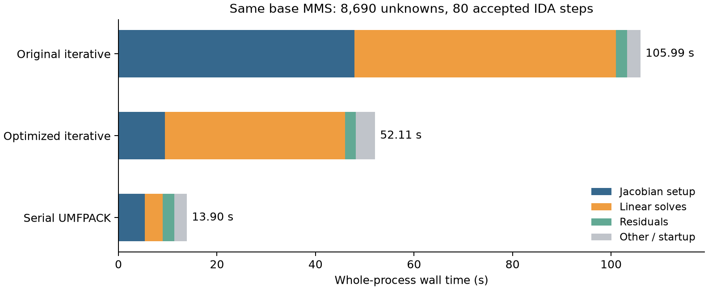

# Cost of the one-vessel elastodynamics MMS

The [one-vessel manufactured solution](../tutorials/metric-flow-x-elastodynamics-mms)
is small enough for a serial sparse direct solve. Its original runtime came
mostly from constructing Jacobian/preconditioner matrices and applying nested
iterative solvers. Finite element assembly, lifted pressure evaluation, and
output account for a small part of the measured time.

## Problem size and measurement scope

Measurements below use the resolved base cube through $t=0.1$, with the same
mesh, quadrature, tolerances, forcing, and output frequency in every solver
comparison:

| Quantity | Base case |
|---|---:|
| Solid cells | 1,024 |
| Displacement unknowns | 4,335 |
| Velocity unknowns | 4,335 |
| Native flow unknowns, including traces | 16 |
| Multiplier unknowns | 4 |
| Full coupled Jacobian dimension | 8,690 |
| Stored Jacobian entries | 1,124,616 initially; 1,124,619 subsequently |

The host is an Apple Mac14,6 with 12 CPU cores and 96 GiB RAM, running
macOS 26.5.1. These are Release executables from a DebugRelease build, using
deal.II 9.8.0-rc1, Trilinos, MetricFlowX 0.1.0, and MPICH 5.0.1.
The installed MetricFlowX source commit was not recorded.
Each application runs on one MPI rank with one application thread. MPI's
libfabric progress threads can still consume CPU time; summed process CPU time
is therefore different from application wall time.

The initial diagnostic run is revision `d50da56`. A sampling profiler was
attached during that run. Compilation was also active on the host, so this
run establishes attribution and a baseline observation, not an isolated speed
comparison. The controlled comparisons below run sequentially with compilation
stopped. Times are local observations, not portable speed guarantees.

## Where the original time goes

The initial run took 113.33 s including startup, and 111 s inside the DAE timer.
IDA accepted 80 steps, requested five Jacobian setups, and performed 137 linear
solves.

| Phase | Calls | Wall time | Fraction of DAE time |
|---|---:|---:|---:|
| Jacobian setup, including Schur preconditioner | 5 | 51.0 s | 46% |
| Linear solves | 137 | 57.2 s | 52% |
| Residual evaluation | 137 | 2.34 s | 2.1% |
| Solid spatial assembly | 1 | 0.0301 s | 0.027% |
| Solid body force assembly | 139 | 0.483 s | 0.44% |
| Solid output | 4 | 0.0118 s | 0.011% |
| Native external-pressure residual | 10,145 | 0.590 s | 0.53% |

The last four rows come from separate component timers. They overlap the
adapter phases and must not be added to them.

Two 15-second macOS `sample` windows explain the expensive phases. Percentages
refer only to samples of the application main thread. Inclusive categories
overlap; their percentages must not be summed.

| Inclusive main-thread stack category | Setup window | Solve window |
|---|---:|---:|
| Jacobian setup | 91.5% | 0% |
| Linear solve | 8.1% | 96.6% |
| Matrix clone/sum | 54.7% | 0% |
| Trilinos row extraction | 38.2% | 0% |
| Operator/function copies | 23.6% | 14.9% |
| AMG hierarchy construction | 0.3% | 0% |
| AMG application | 5.3% | 62.5% |
| Epetra sparse matrix-vector products | 5.7% | 64.9% |

The setup window contained 12,080 main-thread samples; the solve window
contained 6,334. The first started about 14 s after launch and used a 1 ms
sampling interval. The second started about 50 s after launch and used 2 ms.
These windows identify active stacks; they do not measure whole-run phase
percentages. In particular, the samples implicate matrix copying during setup,
not AMG hierarchy construction.

## Why a small system can be expensive

Three implementation details amplify the work:

1. A matrix sum previously invoked the first operand's materializer three
   times and the other materializers twice. Nested sums multiplied this work.
   Each operand is now materialized once per sum and retained for the graph
   and value passes.
2. Repeated calls to Trilinos `end(row)` construct an accessor that extracts
   another row. Calling it for every entry adds approximately
   $O(Nd^2)$ row-copy work to a scan with $N$ rows and $d$ entries per row.
   Cached row-end iterators and the backend's native matrix copy reduce
   these traversals to $O(\mathrm{nnz})$, apart from graph insertion costs.
   Distributed copies retain their row/domain partitions and own their data.
3. Structurally absent blocks previously had zero callbacks without deal.II's
   `is_null_operator` flag. Operator products could therefore execute an
   expensive inverse before multiplying its result by zero. Absent blocks now
   use `dealii::null_operator`, and payload erasure preserves the flag.

A separate five-second sample of the refined direct run found another cost in
block-to-monolithic conversion: all 3,707 main-thread samples were in that
conversion, with 94.69% inside Trilinos `end(row)` and 5.31% in direct
`row_length(row)` calls. For a completely empty block, both `begin(row)` and
`end(row)` search forward for a nonempty row. Visiting every empty row therefore
costs $O(N^2)$ even when the row-end iterator is cached. The conversion now
checks row length before creating iterators and caches row ends for nonempty
rows. These traversals cost approximately $O(N+\mathrm{nnz})$. The diagnostic
refined run was stopped after identifying this issue and is excluded from the
completed-run timing comparisons.

The sum optimization retains all materialized operands simultaneously, requiring
$O(\sum_i \mathrm{nnz}_i)$ temporary matrix storage. It trades that storage for
fewer copies and materializer calls.

The iterative solve also nests a Schur GMRES inside an outer FGMRES. Before
zero-block pruning, an outer preconditioner application with $k$ Schur actions
could invoke approximately $12+4k$ solid AMG applications and $2+k$ native flow
ILU applications. Residual checks add operator actions. Four multiplier
coefficients do not imply four cheap scalar operations: each Schur action can
apply inverses on the full solid mesh.

The Schur construction currently creates the participant inverses once for the
preconditioner and again for its Schur operator: four solid AMG hierarchies and
two flow ILU factorizations per Jacobian setup. This duplication remains; the
profile above shows that matrix copying consumed much more setup time than AMG
hierarchy construction in this case.

The pressure feedback is evaluated through the native flow residual, including
its boundary/interface terms. Creating a new pressure-operator instance requires
one native pressure action per global multiplier coefficient to populate its
cached matrix. Later materializations of that instance copy the cache. With four
coefficients this is small; it can become relevant for a larger network. Increasing axial
quadrature improves the lift but does not explain the dominant costs measured
here.

## MPI diagnostic

A three-second, 2 ms sampling window of rank zero in the optimized two-rank
cylinder test contains 1,144 main-thread samples. Linear solves account for
99.4% of them. Inclusive MPI stacks account for 51.5%, distributed vector
`reinit` for 33.9%, AMG applications for 18.0%, and operator/function copies for
16.7%. These categories overlap: vector reinitialization itself can construct
maps and enter collective communication.

The test completes with the same 40 accepted IDA steps, 99 right-hand sides,
and 4,280 outer FGMRES iterations as the earlier cylinder MPI run. The sample
points to repeated vector construction, synchronization, and operator-copy
allocation inside the nested solves as remaining costs. Compilation was
active during this validation run, so its elapsed time is excluded from the
controlled comparisons below. This diagnostic does not establish MPI scaling.

## Serial UMFPACK path

```text
subsection MetricFlowX coupled solver
  set Linear solver = umfpack
end
```

The default remains `iterative`. The `umfpack` choice requires exactly one MPI
rank and a deal.II installation with UMFPACK. Every IDA Jacobian setup builds
$J=F_y+\alpha F_{\dot y}$ at the callback's current time and state, materializes
the full sparse matrix, and factorizes it with `dealii::SparseDirectUMFPACK`.
All following right-hand sides reuse the factors until the next setup.
The direct path bypasses the nested Schur preconditioner. Its timers distinguish
`Materialize Jacobian`, `Factorize Jacobian`, and `Direct backsolve`.

Sparse LU costs depend on fill and ordering, not just the original number of
entries. For a three-dimensional mesh it should not be assumed to scale
linearly in mesh size or to remain memory-efficient after many refinements.
This option provides a direct reference solve for small serial verification
cases. The matrix-free Jacobian action remains available for checking the true
linear residual.

Distributed runs can select `Linear solver = mumps` when deal.II enables
`DEAL_II_WITH_MUMPS`. This calls `dealii::SparseDirectMUMPS` directly and
reuses each factorization for subsequent right-hand sides. The
[MMS tutorial](../tutorials/metric-flow-x-elastodynamics-mms) provides a
parameter file and MPI command. The measurements below use UMFPACK; they do
not measure MUMPS performance or parallel scaling.

## Controlled comparisons

These runs use the same base input sequentially, without a sampling profiler
or concurrent compilation. The original iterative binary includes the new
solver selector, set to `iterative`, and retains the pre-optimization operator
implementation at `e47b8b5`. The optimized binaries include native matrix copies,
one materialization per sum operand, zero-block pruning, and the monolithic
empty-row fix.

| Solver | Jacobian setup | Linear solves | Residuals | Whole process | Maximum resident size |
|---|---:|---:|---:|---:|---:|
| Original iterative | 47.9 s | 53.1 s | 2.22 s | 105.99 s | 13.07 GiB |
| Optimized iterative | 9.46 s | 36.5 s | 2.21 s | 52.11 s | 1.91 GiB |
| Optimized serial UMFPACK, two runs | 5.32–5.59 s | 3.65–3.70 s | 2.32–2.38 s | 13.90–14.96 s | 1.12 GiB |



All base runs accept 80 IDA steps, use five Jacobian setups, and solve 137
right-hand sides. Both iterative runs perform exactly 1,668 outer FGMRES
iterations, ranging from 5 to 14 per solve. The speedup therefore comes from
less work per setup and operator application, with the same outer iteration
count. The optimized iterative run takes about half the original time; the
direct runs take about one seventh. There is one run of each iterative
configuration and two direct runs; these observations do not estimate timing
variance across machines or long-term performance.

In the final direct runs, materialization takes 3.20–3.31 s, all five LU
factorizations take 0.876–0.954 s, and the 137 backsolves take 3.65–3.70 s.
Materialization and factorization are included in Jacobian setup, and
backsolves are included in linear solves. These nested timers must not be
added a second time. Backsolve time includes conversion between the execution
block vectors and serial vectors. Maximum resident size is macOS
`/usr/bin/time -l`'s process statistic, converted from bytes to GiB; it is
not the sparse factors' storage alone.

The optimized iterative fields are identical to the original exported fields.
Direct-solve differences at final time are at Float32 output precision:
relative nodal differences are below $7\times10^{-9}$ for solid displacement
and velocity, below $4\times10^{-8}$ for the multiplier, and below
$2\times10^{-14}$ for flow velocity. Exported area values are identical.
The solver changes preserve the coarse mesh's discretization errors; the
MMS tutorial reports those errors separately.

The refined cube has 8,192 solid cells, 29,403 unknowns per solid field,
32 native flow unknowns, and eight multiplier unknowns: 58,846 unknowns in
total. The complete refined serial UMFPACK run reaches $t=0.1$ in 120.07 s,
with 69 accepted steps, five Jacobian setups, and 77 right-hand sides.
Its Jacobian stores 8,471,852 entries initially and 8,471,861 subsequently.
Maximum resident size is 7.37 GiB.

| Refined serial direct phase | Wall time |
|---|---:|
| Jacobian materialization | 18.2 s |
| LU factorization | 38.7 s |
| Backsolves, including vector conversion | 40.0 s |
| Residual evaluation | 6.23 s |

Factorization and backsolves now dominate. The unknown count grows by a factor
of 6.77 and stored entries by 7.53; factorization time grows by about 44
relative to the second base run. This is consistent with the cost of sparse
LU fill, but two meshes do not establish an asymptotic scaling rate. The
refined displacement error (16.84%), multiplier error (24.45%), inlet flux
($4.4367093\times10^{-6}$), and relative volume defect (0.04997%) reproduce
the earlier iterative measurements. The earlier refined iterative run used
two ranks, so its 465.83 s is not a same-rank solver comparison.

## Reproduce the measurements

Use the build-tree parameter files, after configuring and building the target:

```bash
cmake --build /path/to/build --target metric_flow_x_elastodynamics -j2
cd /path/to/build
/usr/bin/time -l ./metric_flow_x_elastodynamics \
  tutorials/metric_flow_x_elastodynamics/mms_cube.prm > iterative.log 2>&1
```

For a direct run, create an override outside the source tree:

```text
include /absolute/build/path/tutorials/metric_flow_x_elastodynamics/mms_cube.prm
subsection MetricFlowX coupled solver
  set Linear solver = umfpack
end
subsection Elastodynamics
  set Output directory = /absolute/results/direct/solid
end
subsection MetricFlowSystem<1, 3>
  set Output directory = /absolute/results/direct/flow
end
```

Give each comparison its own output directory and retain the complete logs.
On macOS, sample an active process from another terminal:

```bash
sample PID 15 1 -mayDie -fullPaths -file setup.sample.txt
sample PID 15 2 -mayDie -fullPaths -file solve.sample.txt
```

Choose windows from the actual runtime. A short optimized run may finish before
a 15-second sample completes. Read the main-thread call tree separately from
MPI progress threads and profiler symbolication time. Use full application
timers for phase totals, and sampling stacks to explain those totals.
