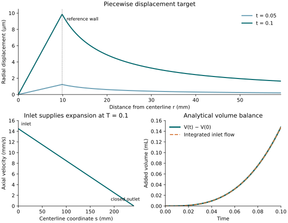

# One vessel in a cube: a manufactured solution

This example prescribes a nonzero, time-dependent radial displacement, vessel
area, axial velocity, and pressure-jump multiplier. A continuous, piecewise
solid displacement supplies the stress jump needed to balance the multiplier.
The inlet supplies the increase in vessel volume; physical continuity has no
distributed mass source.

The inputs exercise all five residual rows of `metric_flow_x_elastodynamics`.
Displacement compatibility is imposed in the multiplier row, while its
traction acts in solid momentum. Continuity has no multiplier reaction.
The flow receives the external pressure $p_{\mathrm{ext}}=-\lambda$ through
native volume, face, boundary, and junction equations.



The plots show the analytical target. No numerical solution is plotted.

## Configure and run

The parameter templates are in `tutorials/metric_flow_x_elastodynamics/`:

| Template | Solid cells | Purpose |
| --- | ---: | --- |
| `mms_cube.prm.in` | $4\times16\times16$ | Single-rank MMS |
| `mms_cube_refined.prm.in` | $4\times32\times32$ | Refine the transverse solid mesh |
| `mms_cube_mpi.prm.in` | $4\times16\times16$ | Separate output directories for MPI |

All cases use one centerline cell, degree-one elements, an automatically
matched multiplier space, and the same analytical target. The solid varies
only in the transverse coordinates, so the refined input keeps the axial
partition fixed. The cross-section refinement level is two in the base and
MPI inputs and three in the refined input, so the refined run also improves
wall geometry.
The target area is constant in space and the target velocity is linear, so
degree one represents both exactly on that centerline cell. Keep flow
refinement at zero: the application imports `a0` from the original VTK mesh
after flow setup and requires matching active cells.

Configure with a compatible MetricFlowX package and deal.II with SUNDIALS and
VTK enabled. For example, from the repository root:

```bash
cmake -S . -B build-mms -DCMAKE_BUILD_TYPE=Release \
  -DMetricFlowX_DIR=/path/to/metric-flow-x/lib/cmake/MetricFlowX
cmake --build build-mms --target metric_flow_x_elastodynamics -j2
```

Require `MetricFlowX support enabled` in the configuration output. Pass
`DEAL_II_DIR` as well if deal.II is not already discoverable. A Debug build
uses the target and executable `metric_flow_x_elastodynamics_debug`.

CMake generates the runtime inputs, including the absolute include path in
the refined and MPI cases. Run the generated `.prm` files from the build
directory so that the application's `last_used_parameters.prm` also stays
there:

```bash
cd build-mms
./metric_flow_x_elastodynamics \
  tutorials/metric_flow_x_elastodynamics/mms_cube.prm
./metric_flow_x_elastodynamics \
  tutorials/metric_flow_x_elastodynamics/mms_cube_refined.prm
mpirun -np 2 ./metric_flow_x_elastodynamics \
  tutorials/metric_flow_x_elastodynamics/mms_cube_mpi.prm
```

Reconfigure after changing a template. These inputs select one spatial solve
each; `Number of refinement cycles` does not make this coupled executable
perform a convergence study. IDA controls its own time steps. `Fixed step`
parameters do not set the IDA step size.

## Geometry and coefficients

The solid fills the cube $\Omega=[-\ell,\ell]^3$, with
$\ell=0.120685$. The straight centerline is
$\gamma=\{(x,0,0):-\ell\le x\le\ell\}$, of length $L=2\ell=0.24137$.
The existing `data/metric_flow_x/single_vessel_centered.vtk.in` supplies

$$
A_0=a_d=3.0605\times10^{-4},\qquad
R_0=\sqrt{A_0/\pi}\simeq0.00987009324508.
$$

No new mesh file is needed. The fictitious solid inside the vessel is part of
the cube. The immersed reference wall is
$\Gamma_0=\{r=R_0\}$, where $r=\sqrt{y^2+z^2}$. Its radius is fixed in the
lift; the current area enters the displacement increment.

The solid density and Lamé coefficients are
$\rho_s=\lambda_s=\mu_s=1$, with zero damping. These are verification
coefficients. Flow density is $1060$, viscosity is zero, and the existing VTK
tube-law properties are retained. The numerical time interval is $0\le t\le
T=0.1$.

## Piecewise solid solution

Let $g(t)=t^3$ and define the spatial vector

$$
w(x,y,z)=
\begin{cases}
(0,y,z), & r\le R_0,\\[2pt]
\displaystyle\frac{R_0^2}{r^2}(0,y,z), & r>R_0.
\end{cases}
$$

The target displacement, velocity, and body force are

$$
u^\star=t^3w,\qquad
v^\star=3t^2w,\qquad
f^\star=6\rho_s t\,w.
$$

The displacement is continuous at $r=R_0$ and regular at the centerline.
Its radial derivative jumps at the wall. Away from the wall, both $r$ and
$R_0^2/r$ solve the radial homogeneous elasticity equation, so
$\operatorname{div}\sigma(u^\star)=0$ in each subdomain. Thus the body force
above supplies the acceleration without a volume approximation to a surface
force.

For

$$
\sigma(u)=2\mu_s\varepsilon(u)+\lambda_s\operatorname{div}(u)I,
$$

the radial stresses at the interface are

$$
\sigma_{rr}^{\mathrm{in}}=2(\lambda_s+\mu_s)g,\qquad
\sigma_{rr}^{\mathrm{out}}=-2\mu_s g.
$$

With $n$ directed from the centerline toward the surrounding solid, the jump
is $[\sigma n]=(\sigma^{\mathrm{in}}-\sigma^{\mathrm{out}})n$.
The momentum balance

$$
(\rho_s\dot v,\phi)_\Omega+
(\sigma(u),\varepsilon(\phi))_\Omega-
(f,\phi)_\Omega+
\int_{\Gamma_0}\lambda\,n\cdot\phi\,d\Gamma-
\int_{\partial\Omega}\tau\cdot\phi\,dS=0
$$

therefore requires

$$
\lambda^\star=-2(\lambda_s+2\mu_s)g=-6t^3.
$$

This is the scalar pressure-jump multiplier. Its negative sign balances the
outward displacement under the positive solid-reaction convention.

All cube faces have boundary id zero. Prescribe the exact outer traction
$\tau^\star=\sigma(u^\star)n_\Omega$ on every face, including the vessel end
planes. Both initial fields are zero.
The initial acceleration and multiplier are also zero, matching the
application's initialization. The parameter expression uses
$R_0^2/\max(y^2+z^2,R_0^2)$ to encode both branches without division by zero.

For $r<R_0$, the stress matrix is
$t^3\operatorname{diag}(2,4,4)$. For $r>R_0$, its nonzero components are

$$
\sigma_{yy}=\frac{2t^3R_0^2(z^2-y^2)}{r^4},\qquad
\sigma_{zz}=-\sigma_{yy},\qquad
\sigma_{yz}=\sigma_{zy}=-\frac{4t^3R_0^2yz}{r^4}.
$$

The boundary expression multiplies this matrix by the appropriate cube-face
normal. It uses a coordinate tolerance of $10^{-10}$ to identify faces and
regularizes denominators in branches where the numerator is zero. No
Dirichlet ids are selected. The transient mass operator and zero initial
displacement/velocity fix the rigid-body motion of this traction problem.

This boundary choice also keeps the lift's affine constraints fixed. A trial
with time-dependent exact Dirichlet data stops with `Lifted affine constraints
changed after static assembly; rebuild the weak term.` The supplied inputs
use exact traction to avoid that separate limitation.

## Area and volume supplied by the inlet

On the reference wall, $u^\star\cdot n=R_0g$. The area-to-radius relation
therefore gives the spatially uniform target

$$
A^\star(t)=A_0(1+t^3)^2,\qquad
\dot A^\star(t)=6A_0t^2(1+t^3).
$$

Let $s=x+\ell\in[0,L]$. Use

$$
Q^\star(s,t)=(L-s)\dot A^\star(t),\qquad
U^\star(x,t)=(\ell-x)\frac{6t^2}{1+t^3}.
$$

These fields satisfy source-free continuity pointwise:

$$
\partial_t A^\star+\partial_s(A^\star U^\star)=0.
$$

At the endpoints,

$$
Q_{\mathrm{in}}^\star=L\dot A^\star,\qquad
Q_{\mathrm{out}}^\star=0,\qquad
\frac{d}{dt}(LA^\star)=Q_{\mathrm{in}}^\star-Q_{\mathrm{out}}^\star.
$$

The inlet function is this nonzero, time-dependent volumetric flow rate.
The outlet uses `Reflection` with `Rt = 1`. The native characteristic
equations then impose zero outlet velocity. Zero outlet flux is compatible
with expansion because the inlet supplies all of the added volume. Setting
both endpoint fluxes to zero would require a distributed mass source.

For this target, the tube-law pressure is uniform along the vessel. With zero
friction, the native momentum equation uses $p=p_{\mathrm{tube}}(A)-\lambda$:

$$
\partial_t U+U\partial_s U+\rho_f^{-1}\partial_s p=S_U.
$$

Consequently the two RHS expressions are

$$
S_A=0,\qquad
S_U=(\ell-x)\frac{12t-42t^4}{(1+t^3)^2}.
$$

Both tube-law pressure and multiplier are spatially uniform for this target.
Their pressure gradient vanishes. Native pressure contributions at faces and
boundaries must still be assembled to cancel the volume contribution.

## Residual rows and their forcing

With $C(u,A)=B^Tu-P_h(A)$, the assembled rows are

$$
\begin{aligned}
F_u &= M(\dot u-v),\\
F_v &= M\dot v+Ku-f+B\lambda,\\
F_A &= F_A^{\mathrm{native}},\\
F_U &= F_U^{\mathrm{native}}+F_U^{\mathrm{pressure}}(-\lambda),\\
F_\lambda &= B^Tu-P_h(A).
\end{aligned}
$$

Here $f$ includes body force and outer Neumann traction. Native algebraic
trace rows also receive their pressure contributions. The displacement
constraint produces a traction
through its derivative with respect to $u$. Introducing $v=\dot u$ places
that traction in the momentum residual, which is registered under $v$.
It does not replace displacement compatibility with a velocity constraint.

The prescribed RHS is zero in the kinematic, continuity, and multiplier rows.
The momentum RHS contains $6t\,w$ and the exact outer traction; the flow
velocity RHS is $S_U$ above. No source compensates for an erroneous multiplier
reaction in continuity. In particular, $-DP_h(A)$ belongs to the multiplier
row's area derivative, and $B$ belongs to the momentum row's multiplier
derivative.

The application shows all coupling terms together: two weak terms for
compatibility, one for momentum traction, and the native pressure residual
with its multiplier derivative. The generic symmetric `make_constraint(...)`
remains appropriate when a constraint's transpose reactions belong to the
same participant residual rows.

The pressure derivative uses native assembly for its forward action. A
transpose or explicit matrix request collectively probes the multiplier basis;
this costs one native assembly per global coefficient. Pressure evaluation
uses the native `CellId` to preserve DG traces and exchanges ghost coefficients.
Pressure coefficients are differentiated at the candidate flow state. The
Jacobian omits derivatives of HLL characteristic-speed weights, following
the native flow Jacobian's frozen-speed approximation. The
application also enables one off-diagonal primal correction in the Schur
approximation, retaining the multiplier-to-velocity-to-displacement path.
Elimination and recovery use the same corrected primal inverse.

## Inspect the solution

Outputs are below the build-tree `test_output/` directory, in separate
`metric-flow-x-mms-cube`, `metric-flow-x-mms-cube-refined`, and
`metric-flow-x-mms-cube-mpi` directories. Each contains solid output and a
`flow/interaction/pressure_jump.pvd` multiplier series. Flow output contains
`area`, `velocity`, `A_hat`, `U_hat`, and `pressure`.

At the final target time $T=0.1$:

| Quantity | Analytical target |
| --- | ---: |
| Area $A^\star$ | $3.0666240605\times10^{-4}$ |
| Radial wall increment $R_0T^3$ | $9.87009324508\times10^{-6}$ |
| Pressure jump $\lambda^\star$ | $-0.006$ |
| Inlet velocity $U^\star(-\ell,T)$ | $0.0144677322677$ |
| Inlet flow $Q_{\mathrm{in}}^\star(T)$ | $4.43670958731\times10^{-6}$ |
| Outlet flow $Q_{\mathrm{out}}^\star(T)$ | $0$ |

In ParaView, compare the solid radial displacement along a transverse line
with $t^3r$ inside and $t^3R_0^2/r$ outside. Compare the centerline area with
$A_0(1+t^3)^2$, axial velocity with $(\ell-x)6t^2/(1+t^3)$, and
`pressure_jump` with $-6t^3$. Use the accepted physical time, not a file index.

The current application leaves the native flow clock at its initial value
when it calls the flow writer. Consequently every timestamp in
`flow/stress_jump.pvd` is zero. Match flow file indices to the accepted times
in `flow/interaction/pressure_jump.pvd` or the solid series. Do not use the
flow PVD timestamps to evaluate the analytical functions. The application
writes the initial state twice; duplicate step-zero entries are not two time
steps.

Check the integrated volume balance independently:

$$
V_h(t)=\int_\gamma A_h\,ds,\qquad
\frac{dV_h}{dt}\mathrel{?}=Q_{\mathrm{in},h}-Q_{\mathrm{out},h}.
$$

For the target, the increase is
$V^\star(t)-V^\star(0)=LA_0[(1+t^3)^2-1]$. A centered difference between outputs
only approximates the volume derivative; distinguish that error from a
conservation defect.

The application does not call either Problem's error routine or produce
coupled error tables. The `Exact solution` entries store the target formulas;
they do not activate error computation. Compare exported fields externally.
Do not claim convergence to this target from successful solver exits or from
agreement between serial and MPI runs. The piecewise stress field, unfitted
solid mesh, cross-section geometry, and time error must also be considered
when interpreting differences between the two meshes.

## Local verification results

Runs on 2026-10-22 used deal.II 9.8.0-rc1, MPICH 5.0.1, and an installed
MetricFlowX package reporting version 0.1.0 with both build variants. The
installed package's source revision was not recorded. Both Release cases
reached $T=0.1$, in 84 and 78 accepted IDA steps respectively.

| Quantity at $T=0.1$ | Base mesh | Refined mesh |
| --- | ---: | ---: |
| $\|u_h-u^\star\|_{L^2(\Omega)}$ | $1.4582\times10^{-7}$ | $9.7307\times10^{-8}$ |
| $\|v_h-v^\star\|_{L^2(\Omega)}$ | $4.5251\times10^{-6}$ | $3.1174\times10^{-6}$ |
| Relative $L^2$ area error | $9.4533\times10^{-7}$ | $9.4533\times10^{-7}$ |
| $\|U_h-U^\star\|_{L^2(\gamma)}$ | $3.7187\times10^{-9}$ | $3.9794\times10^{-9}$ |
| Relative $L^2$ multiplier error | $0.3780$ | $0.2896$ |
| Mean multiplier | $-0.00826795$ | $-0.00426223$ |
| Added volume | $1.4788592\times10^{-7}$ | $1.4788592\times10^{-7}$ |
| Volume defect / prescribed influx | $0.04700\%$ | $0.04700\%$ |

The exact multiplier is $-0.006$, and the integrated prescribed influx is
$1.478164482885\times10^{-7}$. The final inlet traces agree with the prescribed
flux to six significant digits, and outlet flux magnitudes are below
$2.4\times10^{-22}$. The remaining volume difference includes time integration
and output precision errors; it no longer contains an artificial area-row
multiplier source.

Solid displacement, solid velocity, and multiplier errors decrease under this
refinement, but remain substantial. Relative displacement errors are
$0.718$ and $0.480$, and relative solid velocity errors are $0.742$ and $0.513$.
The area and volume measurements agree between meshes at exported precision;
the axial-velocity error remains near $4\times10^{-9}$. These two unfitted
meshes and two wall geometries do not establish an
asymptotic convergence rate. Refine further and reduce the time tolerances
before drawing that conclusion.

The measurements integrate the exported Float32 fields. Solid errors use
three-point tensor-product Gauss quadrature on each cube cell, comparing
interpolated displacement and velocity with the piecewise analytical fields.
Centerline errors, means, and volumes use two-point Gauss quadrature on the
exported linear fields. Relative errors divide by the exact field's $L^2$
norm. The volume defect is the final area integral minus its initial value
and the exact integrated inlet flow. Physical times come from the multiplier
series, because the native flow writer's clock remains at zero.

CTest runs this MMS in Debug and Release, in serial and on two ranks. These
application tests check that integration finishes. Separate integration tests
check multiplier row placement, unchanged continuity, the nonlinear
Jacobian action by finite differences on the single-cell fixture, nonzero
corrections for tiny right-hand sides, and rejection of failed IDA steps in
Release. Field errors and volume
balance provide the independent analytical checks reported above.
